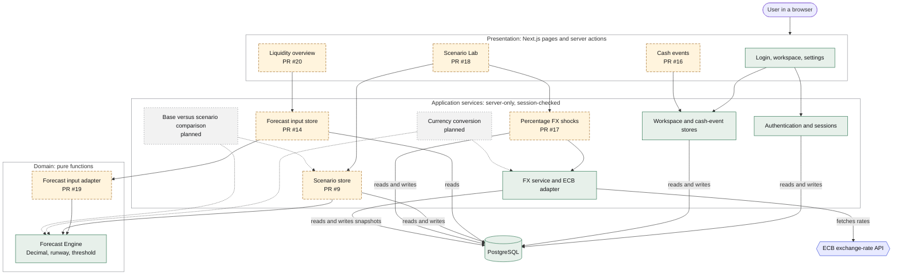

# Architecture

## Component diagram

Status as of 12 October 2026. Solid green boxes are on `main`, dashed amber boxes are in open pull requests and not merged yet, dotted grey boxes are planned and not started. The same status is given in the table below, so the diagram does not rely on colour alone.

| Component | Responsibility | Status | Where |
| --- | --- | --- | --- |
| Pages and server actions | Registration, login, workspace, settings, public home page | Implemented | `src/app`, `src/components` |
| Authentication and sessions | scrypt password hashing, opaque session token stored as a SHA-256 digest, throttling, server-side checks | Implemented | `src/lib/password.ts`, `session-store.ts`, `auth.ts`, `rate-limit.ts` |
| Workspace and cash-event stores | Session-scoped reads and writes, input validation, ownership down the chain user, workspace, account, event | Implemented | `src/lib/workspace-store.ts`, `cash-events-store.ts`, `validation.ts` |
| Forecast Engine | Deterministic projection, runway and danger threshold with Decimal arithmetic; no database, network or UI dependency | Implemented | `src/lib/forecast` |
| FX service and ECB adapter | Fetch, strictly parse and validate ECB data, persist immutable snapshots, classify `CURRENT`, `STALE` or `UNAVAILABLE` | Implemented | `src/lib/fx` |
| Forecast input store | One account's starting balance, overdue events and threshold in one read-only snapshot | Open PR #14 | `src/lib/forecast-input-store.ts` |
| Forecast input adapter | Maps the stored input to the engine's input; pure | Open PR #19 | `src/lib/forecast/input-adapter.ts` |
| Scenario store and delay calculation | Delayed-invoice adjustments as separate rows; base events are never changed | Open PR #9 | `src/lib/scenario-store.ts`, `src/lib/forecast/scenario.ts` |
| Percentage FX shocks | A labelled percentage applied to a stored snapshot, with provenance | Open PR #17 | `src/lib/fx/fx-shock.ts`, `shock-store.ts` |
| Liquidity overview, Cash events, Scenario Lab pages | The three business views | Open PRs #20, #16, #18; placeholders on `main` | `src/app/(protected)` |
| Conversion into the reporting currency | Convert events and the workspace threshold with a persisted snapshot; mark the total unavailable when no usable rate exists | Planned | not started |
| Base versus scenario comparison | Delta between base and scenario with a contribution breakdown that sums to the delta | Planned | not started |

Dependency rules that keep the structure maintainable: the Forecast Engine imports nothing from the database, the framework or the UI; presentation code does not calculate financial results; only server-side code reaches PostgreSQL and the ECB; forecasts read persisted snapshots, never a live market price, so a result can be reproduced.

## Implemented foundation

One Next.js application runs on Node 24. Server components render private pages; server actions process forms. PostgreSQL stores accounts, sessions, workspaces, cash data, and validated ECB exchange-rate snapshots.

Browser → Next.js server action/component → server-only application logic → PostgreSQL.

- `src/app`: routes, server actions, loading/error responses.
- `src/components`: forms and navigation; passwords and tokens are not stored in browser JavaScript state or local storage.
- `src/lib/password.ts`: Node scrypt password hashing and constant-time hash comparison.
- `src/lib/session-store.ts`: random tokens, digest storage, expiry checks, revocation.
- `src/lib/auth.ts`: cookie lookup and server-side authentication requirement.
- `src/lib/workspace-store.ts`, `src/lib/cash-events-store.ts`: session- and ownership-scoped access to workspaces, cash accounts and cash events.
- `src/lib/fx`: server-only ECB fetching, strict response parsing, atomic snapshot persistence, freshness classification, reciprocal rates and same-date cross-rates.
- `src/lib/validation.ts`: server input schemas.
- `src/lib/preferences-store.ts`: session-scoped read and update of the reporting currency.
- `src/lib/currency.ts`, `src/lib/format.ts`: offered currencies and the shared presentation rules for amounts, percentages and timestamps (safe to use in browser components).
- `src/components`: shared page heading, empty state and placeholder figures used by every private page; `src/app/globals.css` holds the design tokens and styles. See [product experience](product-experience.md).
- `scripts/migrate.mjs`, `db/migrations`: reproducible schema changes.

A session is an opaque random value, not a JWT. The browser sends an HttpOnly cookie; PostgreSQL stores its SHA-256 digest. Every protected operation checks the stored expiry. Logout deletes the database session, so replaying the old cookie fails.

Checks exist in protected pages and mutations, and workspace/cash SQL checks ownership again. A layout alone is not the security boundary. User-specific data is not put in a shared application cache. ECB snapshots are the exception: they are public global reference data, not user data.

The exchange-rate path is:

Application service → ECB provider adapter → strict CSV parser → PostgreSQL snapshot cache → typed `CURRENT`, `STALE` or `UNAVAILABLE` result.

The service first checks the cache. A snapshot fetched within one hour is `CURRENT`. Otherwise it attempts one ECB refresh for both EUR/USD and EUR/SGD and writes the validated observations atomically. If refresh fails, a prior validated snapshot is returned as `STALE` together with the refresh failure; without one, the result is `UNAVAILABLE` and its rate is `null`. Reciprocal rates retain the same snapshot metadata. USD/SGD is calculated only when both euro legs share an effective date.

## Later increments

The snapshot/cache layer is not yet wired to Scenario Lab or the forecast workflow on this branch. Holdings, market quotes and `/analytics` remain outside the current cash-forecast MVP. See requirements for the planned calculations and failure states.
