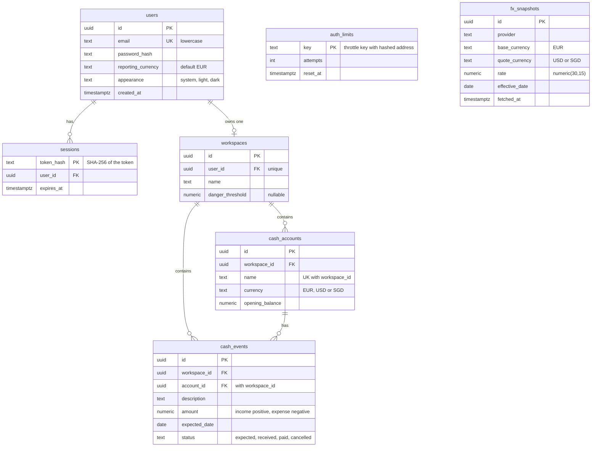
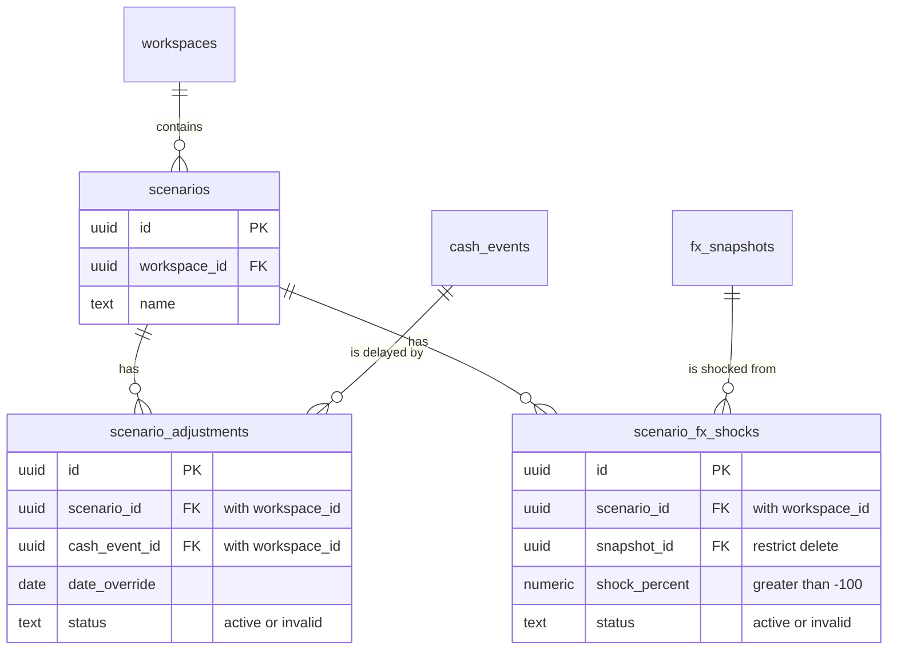

# Database

PostgreSQL 16, accessed through the server-only `pg` driver and parameterized SQL. No ORM or database API is exposed to the browser.

## Entity-relationship diagram

Tables created by migrations 001 to 006, which are on `main`. Only key columns are drawn; the full constraints are in the table below. `PK` is a primary key, `FK` a foreign key and `UK` a unique constraint.

Reading the diagram:

- **Ownership chain.** User, workspace, account, event. `cash_events` carries `workspace_id` and a composite foreign key `(account_id, workspace_id)` to `cash_accounts`, so the database itself refuses an event whose account belongs to another workspace.
- **Global reference data.** `fx_snapshots` has no owner and no relationship to user data. A forecast or scenario that uses a rate refers to one immutable snapshot row; a corrected ECB rate becomes a new row.
- **No currency on events.** An event's currency is its account's currency, so the two cannot disagree.
- **Not drawn.** `schema_migrations` (applied migration history) has no relationships.

### Scenario tables (open pull requests, not on `main`)

Migration `007_scenarios.sql` is in PR #9 and `008_scenario_fx_shocks.sql` in PR #17. A scenario stores only its adjustments; the base events are never copied or edited, which is what makes base and scenario comparable.

- `scenario_adjustments` is unique per scenario and event, and both foreign keys repeat `workspace_id`, so an adjustment cannot point at another workspace's event or scenario.
- `scenario_fx_shocks.snapshot_id` is `ON DELETE RESTRICT`: a snapshot used by a scenario cannot be deleted, so the scenario stays reproducible.

## Implemented tables

| Table | Purpose | Constraints |
| --- | --- | --- |
| users | Email, password hash, reporting currency and appearance | UUID primary key; unique lowercase email; currency of three uppercase letters, default EUR; appearance one of system, light, dark |
| sessions | SHA-256 digest of random session token | Digest primary key; user FK with cascade; expiry |
| auth_limits | Per-address attempt counter | Key primary key; positive count; window expiry |
| workspaces | The user's workspace (the former `portfolios` table, renamed by 005) | UUID primary key; unique user FK, so one per user; trimmed 1–80 character name; optional `danger_threshold` numeric(20,2), NaN excluded |
| cash_accounts | A named account in one currency | UUID primary key; workspace FK with cascade; trimmed 1–80 character name, unique per workspace; currency EUR, USD or SGD; `opening_balance` numeric(20,2), NaN excluded; `UNIQUE (id, workspace_id)` |
| cash_events | One expected income (positive) or expense (negative) on an account | UUID primary key; workspace FK with cascade; composite FK `(account_id, workspace_id)` to `cash_accounts`; trimmed 1–200 character description; amount numeric(20,2), not zero, not NaN; finite date-only `expected_date`; status expected, received, paid or cancelled; received needs amount > 0 and paid needs amount < 0; `UNIQUE (id, workspace_id)` |
| scenarios | A named hypothetical overlay for one workspace | UUID primary key; workspace FK with cascade; trimmed 1–200 character name; `UNIQUE (id, workspace_id)` |
| scenario_adjustments | A delayed date for one cash event in one scenario | Composite workspace-safe FKs to `scenarios` and `cash_events`, both with cascade; finite date-only override; active or invalid status; one adjustment per scenario/event pair |
| scenario_fx_shocks | A percentage shock tied to a scenario and immutable FX snapshot | Composite workspace-safe scenario FK; snapshot FK with delete restricted; shock greater than -100 and not NaN; active or invalid status; one shock per scenario/snapshot pair |
| fx_snapshots | Validated ECB EUR/USD and EUR/SGD observations | UUID primary key; provider and supported pair checks; positive non-NaN numeric(30,15) rate; finite effective date and fetch timestamp; one row per provider, pair and effective date |
| schema_migrations | Applied migration history | Unique migration filename |

Migration `001_accounts.sql` creates users, sessions, and counters. `002_portfolios.sql` is the existing portfolio schema. `003_reporting_currency.sql` adds the reporting currency to `users` and, where the staging runtime role exists, grants it `UPDATE` on that single column. `004_appearance.sql` does the same for the appearance preference. `005_workspace_cash_events.sql` renames `portfolios` to `workspaces`, adds `danger_threshold`, creates `cash_accounts` and `cash_events`, and grants the staging runtime role what the application needs on them. `006_fx_snapshots.sql` creates the global validated ECB cache; `007_scenarios.sql` creates the delayed-invoice overlay tables; `008_scenario_fx_shocks.sql` adds persisted percentage shocks. All three add narrow runtime grants (see [deployment](deployment.md)). Holdings are not present.

## Migrations

`npm run db:migrate` applies migrations to `DATABASE_URL`. The runner locks migrations with a PostgreSQL advisory lock, applies each file in its own transaction, and records it only after success. A second run skips applied files. Do not edit a migration after sharing or applying it; add another migration instead.

`npm run db:migrate:test` uses only `TEST_DATABASE_URL`, whose database name must end in `_test`. Migrations create tables in an existing database; they do not create the PostgreSQL database itself. Integration and browser fixtures remove their own users (cascading sessions, workspaces, accounts, events, scenarios and adjustments) and throttle keys after tests.

## Authorization boundary

Application queries derive ownership from an unexpired session in the database, never a browser-submitted user ID. The workspace read and upsert, the danger threshold, the cash accounts and events, the scenarios and adjustments, and the reporting currency read and update join/select through `sessions`; an expired or unknown token cannot select an owner. This is application-level authorization, not PostgreSQL row-level security. Direct privileged SQL can bypass it, so database credentials stay server-only.

## Environments and privileges

Local development and automated tests use separate databases. The isolated CI PostgreSQL service uses `trust` authentication solely for its ephemeral runner; never use that configuration for an internet-accessible database.

Staging requires its own hosted database and TLS. Use a migration owner for schema changes and a separate runtime role with only the needed table privileges. Runtime credentials must not grant schema modification or access to unrelated projects. Record the actual staging setup in deployment documentation.

Expired sessions and throttle rows are ignored/reset but not periodically deleted yet. A later maintenance procedure should delete expired rows; no scheduler is introduced in Issue 1.

## Cash accounts and cash events (migration 005)

Ownership runs user → workspace → account → event. The chain is enforced twice: every store query starts at an unexpired session and joins down the chain (nothing comes from input), and the database refuses an event whose account belongs to another workspace.

- **Composite foreign key.** `cash_events (account_id, workspace_id)` references `cash_accounts (id, workspace_id)`. That needs `UNIQUE (id, workspace_id)` on `cash_accounts`; `id` is already unique, so the constraint exists only as the foreign key's target. `cash_events` has the same constraint so later tables, such as scenario adjustments, can reference `(event_id, workspace_id)` and a scenario can only point at events of its own workspace.
- **No currency on the event.** An event's currency is its account's currency, so the two can never disagree. The account's currency cannot be changed after creation, so an event's currency cannot change either.
- **Signed amounts.** Income is positive, expense negative, zero is invalid. `received` requires a positive and `paid` a negative amount. `cancelled` and `expected` allow either sign.
- **NaN and infinity.** PostgreSQL accepts `'NaN'` in a `numeric` column and `NaN > 0` is true, so each numeric column has an explicit `<> 'NaN'` check. `numeric(20,2)` already rejects infinity and anything over 18 integer digits. `expected_date` rejects `'infinity'` with `isfinite`. The 2000–2100 date range is an application rule only.
- **Two decimals.** The application rejects amounts with more than two decimals. The database would round them silently on assignment, so the stores never pass such a value.
- **Settled dates.** A settled event's date is the date the money moved: `setCashEventStatus` moves a future date to today (UTC) when the event becomes `received` or `paid`, in the same `UPDATE`. The forecast's starting balance relies on this.
- **Cascade.** Deleting a user removes the workspace, its accounts and its events. Events also cascade from the workspace directly. The account foreign key keeps the default `NO ACTION`: an account that still has events cannot be deleted on its own.
- **Indexes.** `cash_events (workspace_id, expected_date)` serves the per-workspace date-range list. The unique constraints index accounts and the event id lookups; a separate `workspace_id` index would repeat the first column of the composite one.

## ECB exchange-rate snapshots (migration 006)

FX snapshots are global reference data rather than user-owned rows. Only validated EUR/USD and EUR/SGD observations are stored. USD/SGD is derived in memory from two snapshots with the same effective date; snapshots from different dates are never mixed. The store reads `date` as text, returns normalized decimal strings and exposes both the ECB effective date and server fetch time.

One provider response is inserted in one SQL statement, so USD and SGD cannot be partially written. Repeating the same rate and effective date refreshes only its fetch time. If ECB corrects a rate for an existing date, the correction receives a new immutable snapshot id; the old row remains reproducible. An older response arriving late is not selected over a newer one. The database explicitly rejects `NaN`, infinite dates/timestamps, unsupported currency pairs and padded provider names.

## Delayed-invoice scenarios (migration 007)

Scenarios store only date overrides; they do not copy or edit cash events. `workspace_id` is repeated on each adjustment so the database can enforce both `(scenario_id, workspace_id)` and `(cash_event_id, workspace_id)` composite foreign keys. Only an expected positive event can be delayed, and the override must be later than its stored date. Deleting an expected event cascades its adjustment; the canonical store does not allow deleting settled events.

## Percentage-based FX shocks (migration 008)

An FX shock references an immutable snapshot and applies `sourceRate × (1 + shockPercent / 100)` using Decimal arithmetic. A composite foreign key keeps the shock in its scenario's workspace. The snapshot uses `ON DELETE RESTRICT`, so a persisted scenario cannot silently lose its rate provenance. The application accepts only plain decimal percentages greater than -100; the database independently rejects `NaN` and values at or below -100.

The FX service, rather than the Forecast Engine, resolves direct, reciprocal and cross-currency rates. Scenario Lab receives one result containing the requested pair, source and adjusted decimal strings, effective date, provider, source snapshot IDs and `CURRENT`, `STALE` or `UNAVAILABLE`. An unavailable rate produces null source and adjusted rates; no fallback number is invented.
